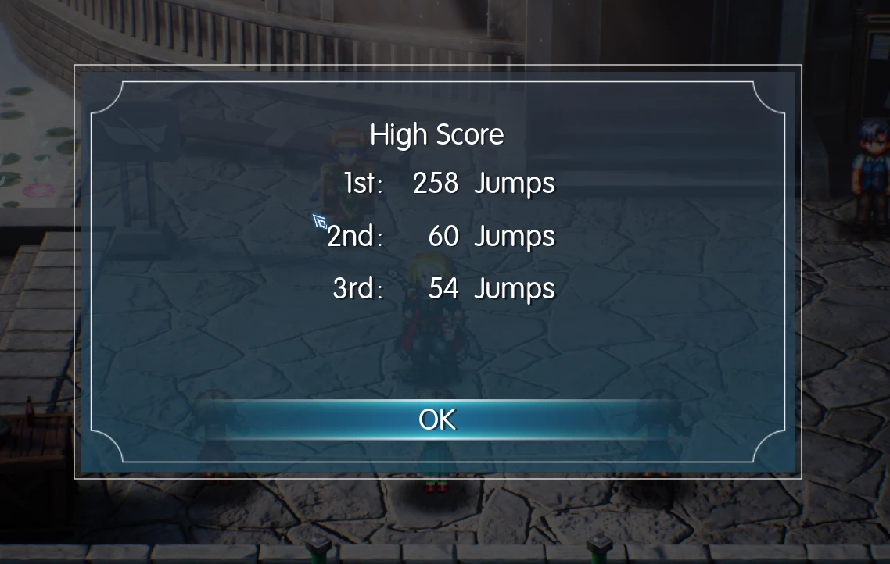
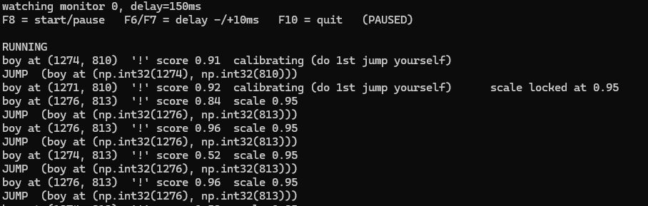

# Jump-Rope Auto-Jumper

**Version 1.0.0**

Plays the jump-rope minigame for you. It watches the yellow-haired boy, and when the **"!" bubble** pops above his head it waits a moment and presses **F**.





## How it works

1. **Finds the boy** by his yellow hair, the biggest yellow patch on screen. Every half second it re-scans the whole screen, so it doesn't get stuck on the yellow lanterns.
2. **Watches for the "!"** in a small box above his head by matching it against `bubble.png`.
3. **Presses F** 0.15 s after the "!" appears. That matches the timing of a human player's successful jumps.
4. **Works out the game's size on screen** from the first "!" it sees (`scale locked at …`), so different resolutions work.

## Setup (Windows only)

```bash
pip install -r requirements.txt
```

Keep `jumprope_bot.py` and `bubble.png` in the same folder.

## Usage

```bash
python jumprope_bot.py
```

1. Start the jump-rope minigame in the game.
2. Press **F8** to start the bot.
3. **Do the first jump yourself.** The bot uses it to calibrate (`scale locked at …`) and jumps for you from then on.

| Key | Action |
|---|---|
| F8 | start / pause |
| F6 / F7 | jump 10 ms earlier / later |
| F10 | quit |

Options:

- `--monitor 1`: watch another monitor (0 = main screen)
- `--delay 0.18`: start with a different delay in seconds
- `--video clip.mp4`: test detection on a recording instead of the live screen

## Status line

```
boy at (1274, 810)  '!' score 0.91  scale 0.95
```

- `boy NOT found`: it can't see him. Try turning **HDR off** or resetting brightness/gamma.
- `'!' score`: about 0.5 normally, above 0.85 when the "!" is showing.
- `JUMP` prints, but the boy doesn't jump: the game is probably running as admin. Open the terminal with **Run as administrator**.

## Tested on

- 2560×1440 fullscreen (scale ≈ 1.0)
- Recordings shrunk to 70% and enlarged to 125%

Very small resolutions (about 720p) are at the edge of what it can detect.
